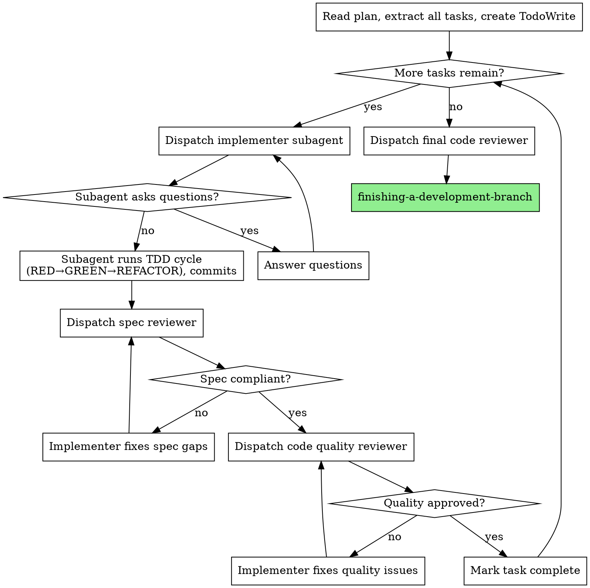

# TDD-Driven Development

Execute a plan by dispatching a fresh subagent per task, each following the full TDD cycle, with two-stage review after each task.

**Core principle:** Fresh subagent per task + TDD cycle enforced + two-stage review (spec then quality) = high quality, disciplined iteration.

**REQUIRED: `tdd-enforcement` is always loaded. The iron law applies to every dispatched subagent.**

## When to Use

- You have a written plan from `writing-plans`
- Tasks are mostly independent
- You want TDD discipline enforced at every step

## The Process



## Prompt Templates

- `implementer-prompt.md` — dispatch implementer subagent (enforces TDD cycle)
- `spec-reviewer-prompt.md` — dispatch spec compliance reviewer
- `code-quality-reviewer-prompt.md` — dispatch code quality reviewer

## Example Workflow

```
[Read plan: specs/feature-plan.md]
[Extract all 4 tasks with full text]
[Create TodoWrite with all tasks]

Task 1: User login

[Dispatch implementer with full task text]
Implementer: "Should login be case-insensitive for email?"
You: "Yes, lowercase before comparison."
Implementer:
  - RED: wrote login.test.ts, confirmed FAIL
  - GREEN: minimal implementation, tests PASS
  - REFACTOR: extracted validation helper
  - Committed

[Dispatch spec reviewer]
Spec reviewer: ✅ All requirements met

[Dispatch code quality reviewer]
Code reviewer: ✅ Approved

[Mark Task 1 complete]

Task 2: User logout
...
```

## Red Flags

**Never:**
- Skip spec compliance review before code quality review
- Proceed with open issues from either reviewer
- Let implementer self-review replace actual review
- Accept "close enough" on spec compliance
- Skip re-review after fixes
- Move to next task while current has open issues

**If subagent asks questions:** Answer before letting them proceed.
**If reviewer finds issues:** Implementer fixes → reviewer re-reviews → only then proceed.
