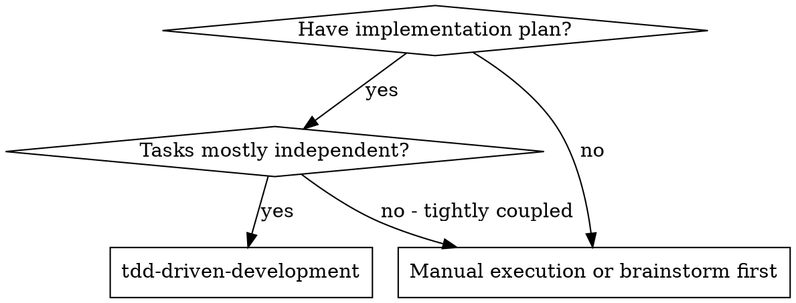
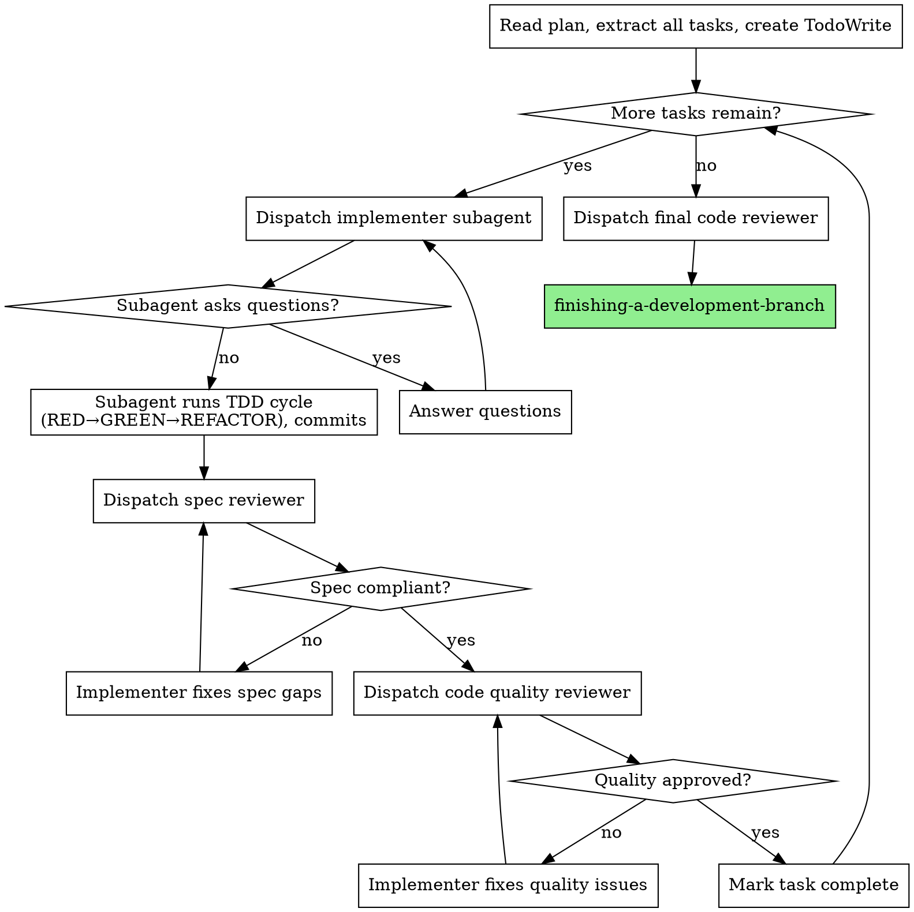

# TDD-Driven Development

Execute a plan by dispatching a fresh subagent per task, each following the full TDD cycle, with two-stage review after each task.

**Core principle:** Fresh subagent per task + TDD cycle enforced + two-stage review (spec then quality) = high quality, disciplined iteration.

**REQUIRED: `tdd-enforcement` is always loaded. The iron law applies to every dispatched subagent.**

## When to Use



**vs. Manual execution:**
- Fresh subagent per task (no context pollution)
- TDD cycle enforced at every step
- Two-stage review catches issues before they compound

## The Process



## Prompt Templates

- `implementer-prompt.md` — dispatch implementer subagent (enforces TDD cycle)
- `spec-reviewer-prompt.md` — dispatch spec compliance reviewer
- `code-quality-reviewer-prompt.md` — dispatch code quality reviewer

## Example Workflow

```
[Read plan: specs/feature-plan.md]
[Extract all 4 tasks with full text]
[Create TodoWrite with all tasks]

Task 1: User login

[Dispatch implementer with full task text]
Implementer: "Should login be case-insensitive for email?"
You: "Yes, lowercase before comparison."
Implementer:
  - RED: wrote login.test.ts, confirmed FAIL
  - GREEN: minimal implementation, tests PASS
  - REFACTOR: extracted validation helper
  - Committed

[Dispatch spec reviewer]
Spec reviewer: ✅ All requirements met

[Dispatch code quality reviewer]
Code reviewer: ✅ Approved

[Mark Task 1 complete]

Task 2: User logout
...
```

## Efficiency

- No file reading overhead — controller provides full task text to subagent, subagent never reads plan file
- Controller curates exactly what context is needed per task
- Questions surfaced before work begins, not mid-implementation
- Self-review catches issues before handoff to reviewer
- Catching issues per task is cheaper than fixing them after all tasks complete

**Cost:** more subagent invocations (implementer + 2 reviewers per task) and review loops add iterations — but catching issues early is cheaper than debugging later.

## Red Flags

**Never:**
- Skip reviews (spec compliance OR code quality)
- Proceed with unfixed issues
- Dispatch multiple implementation subagents in parallel (conflicts)
- Make subagent read the plan file (provide full text instead)
- Skip scene-setting context (subagent needs to understand where the task fits)
- Ignore subagent questions (answer before letting them proceed)
- Accept "close enough" on spec compliance (spec reviewer found issues = not done)
- Skip review loops (reviewer found issues = implementer fixes = review again)
- Let implementer self-review replace actual review (both are needed)
- **Start code quality review before spec compliance is ✅** (wrong order)
- Move to next task while either review has open issues

**If subagent asks questions:**
- Answer clearly and completely
- Provide additional context if needed
- Don't rush them into implementation

**If reviewer finds issues:**
- Implementer (same subagent) fixes them
- Reviewer reviews again
- Repeat until approved
- Don't skip the re-review

**If subagent fails task:**
- Dispatch fix subagent with specific instructions
- Don't try to fix manually (context pollution)

## Integration

**Required:**
- `writing-plans` — creates the plan this skill executes
- `requesting-code-review` — code review template for quality reviewer subagents
- `finishing-a-development-branch` — completes development after all tasks

**Subagents must use:**
- `test-driven-development` — TDD cycle for each task
- `tdd-enforcement` — always loaded, iron law applies
