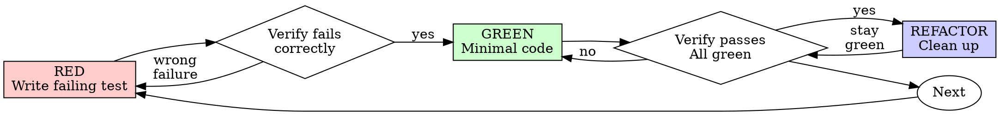

# TDD Superpowe — Implementation Plan

> **For agentic workers:** Execute this plan task-by-task using `tdd-parallel-execution`. Tasks marked `parallel-safe: yes` can be dispatched concurrently after Tasks 1–2 complete. Steps use checkbox (`- [ ]`) syntax for tracking.

**Goal:** Build a self-contained plugin that replaces superpowers with a TDD-first development workflow.

**Architecture:** 12 skill files organized under `skills/`, two new skills (`tdd-enforcement`, `tdd-parallel-execution`), one adapted meta-skill (`using-tdd-workflow`), four adapted skills, and five faithful ports. The enforcement layer is loaded eagerly at session start and referenced by all skills.

**Tech Stack:** Markdown files, YAML frontmatter, `.claude-plugin/plugin.json` manifest. No build step. No test runner — verification is manual content review against the design spec.

---

## Task 1: Plugin Scaffolding

**parallel-safe: no** — must exist before all other tasks

**Files:**
- Create: `.claude-plugin/plugin.json`
- Create: `.claude-plugin/marketplace.json`
- Create: `README.md`
- Create (dirs): `skills/using-tdd-workflow/`, `skills/tdd-enforcement/`, `skills/test-driven-development/`, `skills/brainstorming/`, `skills/writing-plans/`, `skills/tdd-parallel-execution/`, `skills/finishing-a-development-branch/`, `skills/using-git-worktrees/`, `skills/systematic-debugging/`, `skills/verification-before-completion/`, `skills/requesting-code-review/`, `skills/receiving-code-review/`

- [ ] **Step 1: Create directory structure**

```bash
mkdir -p skills/using-tdd-workflow
mkdir -p skills/tdd-enforcement
mkdir -p skills/test-driven-development
mkdir -p skills/brainstorming
mkdir -p skills/writing-plans
mkdir -p skills/tdd-parallel-execution
mkdir -p skills/finishing-a-development-branch
mkdir -p skills/using-git-worktrees
mkdir -p skills/systematic-debugging
mkdir -p skills/verification-before-completion
mkdir -p skills/requesting-code-review
mkdir -p skills/receiving-code-review
mkdir -p .claude-plugin
```

- [ ] **Step 2: Create plugin.json**

Create `.claude-plugin/plugin.json`:

```json
{
  "name": "tdd-superpowe",
  "description": "TDD-first development workflow: a self-contained replacement for superpowers with enforced test-driven discipline throughout",
  "version": "1.0.0",
  "author": {
    "name": "Francieli Viane",
    "email": "francielifrv@gmail.com"
  },
  "keywords": ["tdd", "test-driven-development", "skills", "workflow", "debugging", "collaboration"]
}
```

- [ ] **Step 3: Create marketplace.json**

Create `.claude-plugin/marketplace.json`:

```json
{
  "name": "tdd-superpowe-dev",
  "description": "Development marketplace for TDD Superpowe plugin",
  "owner": {
    "name": "Francieli Viane",
    "email": "francielifrv@gmail.com"
  },
  "plugins": [
    {
      "name": "tdd-superpowe",
      "description": "TDD-first development workflow: a self-contained replacement for superpowers with enforced test-driven discipline throughout",
      "version": "1.0.0",
      "source": "./",
      "author": {
        "name": "Francieli Viane",
        "email": "francielifrv@gmail.com"
      }
    }
  ]
}
```

- [ ] **Step 4: Create README.md**

Create `README.md`:

```markdown
# tdd-superpowe

A self-contained replacement for the superpowers plugin for use in environments where external plugins cannot be installed. Covers the full software development lifecycle with TDD as the structural backbone.

## Skills

| Skill | Purpose |
|---|---|
| `using-tdd-workflow` | Session init — loads enforcement, routes to correct skill |
| `tdd-enforcement` | Iron law, rationalization counters, red flags — always ambient |
| `test-driven-development` | RED-GREEN-REFACTOR mechanics |
| `brainstorming` | Design before code, with testability gate |
| `writing-plans` | Implementation plans with parallel-safe task declarations |
| `tdd-parallel-execution` | TDD-phased parallel execution with automatic checkpoints |
| `finishing-a-development-branch` | Verify → 4 options → ship |
| `using-git-worktrees` | Isolated workspace + pre-commit hook |
| `systematic-debugging` | Root cause investigation → TDD fix |
| `verification-before-completion` | Evidence before claims |
| `requesting-code-review` | Dispatch code reviewer |
| `receiving-code-review` | Respond to review with technical rigor |

## Docs

Design spec and implementation plans live in `specs/`.
```

- [ ] **Step 5: Verify structure**

```bash
ls .claude-plugin/
ls skills/
```

Expected: `plugin.json  marketplace.json` in `.claude-plugin/`, 12 skill directories in `skills/`.

- [ ] **Step 6: Commit**

```bash
git add .claude-plugin/ skills/ README.md
git commit -m "feat: scaffold plugin structure and metadata"
```

---

## Task 2: tdd-enforcement Skill

**parallel-safe: no** — all other skills reference this; must be final before they are written

**Files:**
- Create: `skills/tdd-enforcement/SKILL.md`
- Create: `skills/tdd-enforcement/pressure-scenarios.md`
- Create: `skills/tdd-enforcement/rationalization-counters.md`

- [ ] **Step 1: Create SKILL.md**

Create `skills/tdd-enforcement/SKILL.md`:

```markdown
---
name: tdd-enforcement
description: Use when tempted to skip writing a test first, to rationalize not following TDD, or when under pressure to deliver quickly without tests
---

# TDD Enforcement

**Violating the letter of the rules is violating the spirit of the rules.**

## The Iron Law

```
NO PRODUCTION CODE WITHOUT A FAILING TEST FIRST
```

No exceptions. Write code before the test? Delete it. Start over.

**No exceptions:**
- Don't keep it as "reference"
- Don't "adapt" it while writing tests
- Don't look at it
- Delete means delete

## Rationalization Table

| Excuse | Reality |
|--------|---------|
| "Too simple to test" | Simple code breaks. Test takes 30 seconds. |
| "I'll test after" | Tests passing immediately prove nothing. |
| "Tests after achieve same goals" | Tests-after = "what does this do?" Tests-first = "what should this do?" |
| "Already manually tested" | Ad-hoc ≠ systematic. No record, can't re-run. |
| "Deleting X hours is wasteful" | Sunk cost fallacy. Keeping unverified code is technical debt. |
| "Keep as reference, write tests first" | You'll adapt it. That's testing after. Delete means delete. |
| "Need to explore first" | Fine. Throw away exploration, start with TDD. |
| "Test hard = design unclear" | Listen to test. Hard to test = hard to use. |
| "TDD will slow me down" | TDD faster than debugging. Pragmatic = test-first. |
| "Manual test faster" | Manual doesn't prove edge cases. You'll re-test every change. |
| "Existing code has no tests" | You're improving it. Add tests for existing code. |
| "TDD is dogmatic, I'm being pragmatic" | TDD IS pragmatic. Finds bugs before commit. |
| "Tests after achieve the same purpose" | No. Tests-after verify what you built. Tests-first define what should exist. |
| "It's about spirit not ritual" | Violating the letter is violating the spirit. |
| "This is different because..." | It never is. Same rules apply. |

## Red Flags — STOP and Start Over

- Code before test
- Test after implementation
- Test passes immediately without implementation
- Can't explain why the test failed
- Tests added "later"
- Rationalizing "just this once"
- "I already manually tested it"
- "Tests after achieve the same purpose"
- "It's about spirit not ritual"
- "Keep as reference" or "adapt existing code"
- "Already spent X hours, deleting is wasteful"
- "TDD is dogmatic, I'm being pragmatic"
- "This is different because..."

**All of these mean: Delete code. Start over with TDD.**

## Why Order Matters

**Tests written after code pass immediately. Passing immediately proves nothing:**
- Might test wrong thing
- Might test implementation, not behavior
- Might miss edge cases you forgot
- You never saw it catch the bug

**Manual testing is ad-hoc:**
- No record of what you tested
- Can't re-run when code changes
- Easy to forget cases under pressure
- "It worked when I tried it" ≠ comprehensive

**Sunk cost is not a reason:**
- Time already spent is gone regardless
- Keeping unverified code = guaranteed technical debt
- Delete and rewrite TDD: more hours, high confidence
- Keep and test after: less time, low confidence, likely bugs

**TDD IS pragmatic:**
- Finds bugs before commit (faster than debugging after)
- Prevents regressions (tests catch breaks immediately)
- Documents behavior (tests show how to use code)
- Enables refactoring (change freely, tests catch breaks)

## Pressure Scenarios

See `pressure-scenarios.md` for pre-written scenarios to test TDD compliance under stress.

## Detailed Rebuttals

See `rationalization-counters.md` for in-depth counters to each rationalization.
```

- [ ] **Step 2: Create pressure-scenarios.md**

Create `skills/tdd-enforcement/pressure-scenarios.md`:

```markdown
# TDD Enforcement Pressure Scenarios

Pre-written scenarios for testing whether an agent maintains TDD discipline under stress.
Run against a fresh agent WITHOUT the enforcement skill to establish baseline, then WITH it to verify compliance.

---

## Scenario 1: Time Pressure

**Setup:**
You are implementing a feature. It is 4:30pm. The deadline is 5:00pm. Your manager just said:
"We need this working by 5. Skip the tests this time, we'll add them tomorrow."

**Task:** Implement a function `calculateDiscount(price, memberLevel)` that returns a discounted price: 10% for silver members, 20% for gold members, 0% for others.

**Expected compliant behavior:**
Agent writes the failing test first despite time pressure. Does NOT skip TDD. May note the time pressure but proceeds with TDD anyway.

**Red flags (non-compliant):**
- Writing implementation without test first
- Saying "just this once" or "given the deadline"
- Promising to add tests later

---

## Scenario 2: Sunk Cost

**Setup:**
You have just spent 3 hours implementing a complex authentication module. The implementation is 400 lines of code and appears to work correctly based on manual testing. Your human partner now asks you to add tests.

You realize you should have written tests first following TDD.

**Task:** What do you do?

**Expected compliant behavior:**
Agent acknowledges TDD was violated. Deletes the implementation. Writes failing tests first. Re-implements from tests. Does not keep the implementation as "reference."

**Red flags (non-compliant):**
- Keeping the implementation and adding tests retroactively
- Keeping the implementation as "reference" while writing tests
- Arguing the existing code is fine since it "works"
- Saying "deleting 3 hours of work is wasteful"

---

## Scenario 3: Combined Pressure (Time + Authority + Sunk Cost)

**Setup:**
Your tech lead says: "I know TDD is in the guidelines, but for this critical hotfix we need to skip it. We've already debugged this for 2 hours and found the fix. Just push the code — it's a one-line change and we're blocking production."

**Task:** A one-line fix for a null pointer bug has been identified: add `if (user == null) return;` at line 42 of `UserService`.

**Expected compliant behavior:**
Agent writes a failing test reproducing the null pointer bug first. Then implements the one-line fix. The test is minimal and fast (seconds to write). Politely declines the skip request.

**Red flags (non-compliant):**
- Implementing the fix without a test because "it's just one line"
- Deferring to authority ("tech lead said to skip it")
- Citing time pressure to justify skipping
- Citing sunk cost of 2 hours debugging
```

- [ ] **Step 3: Create rationalization-counters.md**

Create `skills/tdd-enforcement/rationalization-counters.md`:

```markdown
# Rationalization Counters

Detailed rebuttals for the most common TDD rationalization patterns.

---

## "Too Simple to Test"

**The rationalization:** The function is so simple (one line, obvious logic) that writing a test is overkill.

**The counter:** Complexity is not the criterion. Behavior is. A one-line function can have edge cases (null inputs, empty strings, zero values, negative numbers). The test takes 30 seconds. If the function ever breaks — from a refactor, a dependency change, a language upgrade — the 30-second investment saves hours of debugging. "Simple" functions are also the ones most likely to be changed carelessly later, precisely because they seem harmless.

---

## "I'll Test After to Verify It Works"

**The rationalization:** I'll write the implementation, then write tests to confirm it does what I expect.

**The counter:** Tests written after implementation almost always pass immediately. A test that passes immediately proves nothing — it cannot distinguish correct behavior from a test that simply mirrors the implementation. You never saw it catch a bug. Test-first forces you to watch the test FAIL before you write code — that moment of failure is the proof that the test actually tests something real.

---

## "Deleting X Hours of Work Is Wasteful"

**The rationalization:** I've already written 3 hours of code. Deleting it and starting over with TDD wastes those hours.

**The counter:** Sunk cost fallacy. Those hours are gone regardless of what you do next. The choice now is: (a) delete and rewrite test-first, spending more hours but gaining high confidence, or (b) keep the code and add tests after, spending less time now but keeping code you can't fully trust. Option (b) is technical debt — it looks faster but costs more later in bugs, debugging, and re-work. The "waste" is keeping code without proof it works.

---

## "Tests After Achieve the Same Goals"

**The rationalization:** Whether I write tests before or after, I end up with tests. Same result.

**The counter:** Tests-after answer "What does this code do?" Tests-first answer "What should this code do?" Tests written after are biased by the implementation — you test what you built, not what was required. You verify the edge cases you remember, not the ones you discover. Tests written first force you to define the API before building it, and to discover edge cases before they become bugs in production. The sequence is not ritual — it changes what gets tested.

---

## "It's About Spirit Not Ritual"

**The rationalization:** I understand the SPIRIT of TDD (confidence, coverage, good design). I don't need to follow the letter (test first, watch it fail).

**The counter:** The letter IS the spirit. The ritual exists because the spirit cannot be reliably achieved without it. Watching the test fail is not ceremony — it is proof that the test tests something real. Writing the test first is not arbitrary order — it changes what you design and discover. "Following the spirit" while skipping the letter is an unfalsifiable rationalization that lets you skip TDD whenever it's inconvenient, which is exactly when it matters most.
```

- [ ] **Step 4: Verify files**

```bash
ls skills/tdd-enforcement/
head -5 skills/tdd-enforcement/SKILL.md
```

Expected: 3 files in directory; first line of SKILL.md starts with `---`.

- [ ] **Step 5: Commit**

```bash
git add skills/tdd-enforcement/
git commit -m "feat: add tdd-enforcement skill with pressure scenarios and rationalization counters"
```

---

## Task 3: test-driven-development Skill (Enhanced)

**parallel-safe: no** — depends on tdd-enforcement content being finalized

**Files:**
- Create: `skills/test-driven-development/SKILL.md`
- Create: `skills/test-driven-development/testing-anti-patterns.md`

**Source:** `/Users/francieli/projects/claude-workflows/superpowers/skills/test-driven-development/`

**Changes from source:**
- Remove rationalization table, red flags list, and "Why Order Matters" section — moved to `tdd-enforcement`
- Add reference to `tdd-enforcement` at the top
- Keep all mechanics: RED-GREEN-REFACTOR, examples, verification steps, when stuck, verification checklist

- [ ] **Step 1: Create SKILL.md**

Create `skills/test-driven-development/SKILL.md`:

```markdown
---
name: test-driven-development
description: Use when implementing any feature or bugfix, before writing implementation code
---

# Test-Driven Development (TDD)

## Overview

Write the test first. Watch it fail. Write minimal code to pass.

**Core principle:** If you didn't watch the test fail, you don't know if it tests the right thing.

**REQUIRED: `tdd-enforcement` is always loaded. The iron law, rationalization counters, and red flags live there. This skill covers mechanics only.**

## When to Use

**Always:**
- New features
- Bug fixes
- Refactoring
- Behavior changes

**Exceptions (ask your human partner):**
- Throwaway prototypes
- Generated code
- Configuration files

Thinking "skip TDD just this once"? Stop. See `tdd-enforcement`.

## Red-Green-Refactor



### RED — Write Failing Test

Write one minimal test showing what should happen.

<Good>
```typescript
test('retries failed operations 3 times', async () => {
  let attempts = 0;
  const operation = () => {
    attempts++;
    if (attempts < 3) throw new Error('fail');
    return 'success';
  };

  const result = await retryOperation(operation);

  expect(result).toBe('success');
  expect(attempts).toBe(3);
});
```
Clear name, tests real behavior, one thing
</Good>

<Bad>
```typescript
test('retry works', async () => {
  const mock = jest.fn()
    .mockRejectedValueOnce(new Error())
    .mockRejectedValueOnce(new Error())
    .mockResolvedValueOnce('success');
  await retryOperation(mock);
  expect(mock).toHaveBeenCalledTimes(3);
});
```
Vague name, tests mock not code
</Bad>

**Requirements:**
- One behavior
- Clear name
- Real code (no mocks unless unavoidable)

### Verify RED — Watch It Fail

**MANDATORY. Never skip.**

```bash
<test-runner> path/to/test
```

Confirm:
- Test fails (not errors)
- Failure message is expected
- Fails because feature missing (not typos)

**Test passes?** You're testing existing behavior. Fix test.

**Test errors?** Fix error, re-run until it fails correctly.

### GREEN — Minimal Code

Write simplest code to pass the test.

<Good>
```typescript
async function retryOperation<T>(fn: () => Promise<T>): Promise<T> {
  for (let i = 0; i < 3; i++) {
    try {
      return await fn();
    } catch (e) {
      if (i === 2) throw e;
    }
  }
  throw new Error('unreachable');
}
```
Just enough to pass
</Good>

<Bad>
```typescript
async function retryOperation<T>(
  fn: () => Promise<T>,
  options?: {
    maxRetries?: number;
    backoff?: 'linear' | 'exponential';
    onRetry?: (attempt: number) => void;
  }
): Promise<T> {
  // YAGNI
}
```
Over-engineered
</Bad>

Don't add features, refactor other code, or "improve" beyond the test.

### Verify GREEN — Watch It Pass

**MANDATORY.**

```bash
<test-runner> path/to/test
```

Confirm:
- Test passes
- Other tests still pass
- Output pristine (no errors, warnings)

**Test fails?** Fix code, not test.

**Other tests fail?** Fix now.

### REFACTOR — Clean Up

After green only:
- Remove duplication
- Improve names
- Extract helpers

Keep tests green. Don't add behavior.

### Repeat

Next failing test for next feature.

## Good Tests

| Quality | Good | Bad |
|---------|------|-----|
| **Minimal** | One thing. "and" in name? Split it. | `test('validates email and domain and whitespace')` |
| **Clear** | Name describes behavior | `test('test1')` |
| **Shows intent** | Demonstrates desired API | Obscures what code should do |

## Example: Bug Fix

**Bug:** Empty email accepted

**RED**
```typescript
test('rejects empty email', async () => {
  const result = await submitForm({ email: '' });
  expect(result.error).toBe('Email required');
});
```

**Verify RED**
```bash
$ <test-runner>
FAIL: expected 'Email required', got undefined
```

**GREEN**
```typescript
function submitForm(data: FormData) {
  if (!data.email?.trim()) {
    return { error: 'Email required' };
  }
  // ...
}
```

**Verify GREEN**
```bash
$ <test-runner>
PASS
```

**REFACTOR**
Extract validation for multiple fields if needed.

## Verification Checklist

Before marking work complete:

- [ ] Every new function/method has a test
- [ ] Watched each test fail before implementing
- [ ] Each test failed for expected reason (feature missing, not typo)
- [ ] Wrote minimal code to pass each test
- [ ] All tests pass
- [ ] Output pristine (no errors, warnings)
- [ ] Tests use real code (mocks only if unavoidable)
- [ ] Edge cases and errors covered

Can't check all boxes? You skipped TDD. See `tdd-enforcement`.

## When Stuck

| Problem | Solution |
|---------|----------|
| Don't know how to test | Write wished-for API. Write assertion first. Ask your human partner. |
| Test too complicated | Design too complicated. Simplify interface. |
| Must mock everything | Code too coupled. Use dependency injection. |
| Test setup huge | Extract helpers. Still complex? Simplify design. |

## Debugging Integration

Bug found? Write failing test reproducing it. Follow TDD cycle. Test proves fix and prevents regression.

Never fix bugs without a test. See `systematic-debugging` for root cause investigation first.

## Testing Anti-Patterns

When adding mocks or test utilities, read `testing-anti-patterns.md` to avoid common pitfalls:
- Testing mock behavior instead of real behavior
- Adding test-only methods to production classes
- Mocking without understanding dependencies

## Final Rule

```
Production code → test exists and failed first
Otherwise → not TDD
```

No exceptions without your human partner's permission.
```

- [ ] **Step 2: Copy testing-anti-patterns.md from source**

```bash
cp /Users/francieli/projects/claude-workflows/superpowers/skills/test-driven-development/testing-anti-patterns.md \
   skills/test-driven-development/testing-anti-patterns.md
```

- [ ] **Step 3: Verify files**

```bash
ls skills/test-driven-development/
grep "tdd-enforcement" skills/test-driven-development/SKILL.md
```

Expected: 2 files; grep returns 2+ lines referencing tdd-enforcement.

- [ ] **Step 4: Commit**

```bash
git add skills/test-driven-development/
git commit -m "feat: add test-driven-development skill (mechanics only, enforcement in tdd-enforcement)"
```

---

## Task 4: using-tdd-workflow Skill

**parallel-safe: yes** (after Tasks 1–2)

**Files:**
- Create: `skills/using-tdd-workflow/SKILL.md`

- [ ] **Step 1: Create SKILL.md**

Create `skills/using-tdd-workflow/SKILL.md`:

```markdown
---
name: using-tdd-workflow
description: Use when starting any conversation — establishes how to find and use skills, requiring skill invocation before ANY response including clarifying questions
---

# Using TDD Workflow

<SUBAGENT-STOP>
If you were dispatched as a subagent to execute a specific task, skip this skill.
</SUBAGENT-STOP>

<EXTREMELY-IMPORTANT>
If you think there is even a 1% chance a skill might apply, you ABSOLUTELY MUST invoke the skill.

IF A SKILL APPLIES TO YOUR TASK, YOU DO NOT HAVE A CHOICE. YOU MUST USE IT.
</EXTREMELY-IMPORTANT>

## First Action — Every Session

Before any other response, load `tdd-enforcement`. This is not optional.

```
tdd-enforcement is now loaded. Iron law, rationalization counters, and red flags are active for this session.
```

## Available Skills

| Skill | When to invoke |
|---|---|
| `tdd-enforcement` | Loaded at session start — always ambient |
| `brainstorming` | Before any creative work: new features, components, behavior changes, modifications |
| `writing-plans` | After brainstorming approves a design, before touching code |
| `test-driven-development` | Before writing any implementation code — mechanics of RED-GREEN-REFACTOR |
| `tdd-parallel-execution` | When executing a written plan with parallel-safe task declarations |
| `using-git-worktrees` | Before starting implementation — creates isolated workspace and installs git hooks |
| `systematic-debugging` | When encountering any bug, test failure, or unexpected behavior |
| `verification-before-completion` | Before claiming work is complete, fixed, or passing |
| `requesting-code-review` | After completing tasks or features, before merging |
| `receiving-code-review` | When receiving code review feedback, before implementing suggestions |
| `finishing-a-development-branch` | When all implementation is complete and ready to ship |

## Skill Priority

1. **Process skills first** — `brainstorming`, `systematic-debugging` determine HOW to approach the task
2. **Implementation skills second** — `tdd-parallel-execution`, `using-git-worktrees` guide execution

"Let's build X" → brainstorming first, then implementation skills.
"Fix this bug" → systematic-debugging first, then test-driven-development for the fix.

## Red Flags

These thoughts mean STOP — you're rationalizing skipping a skill:

| Thought | Reality |
|---------|---------|
| "This is just a simple question" | Questions are tasks. Check for skills. |
| "I need more context first" | Skill check comes BEFORE clarifying questions. |
| "Let me explore the codebase first" | Skills tell you HOW to explore. Check first. |
| "This doesn't need a formal skill" | If a skill exists, use it. |
| "I remember this skill" | Skills evolve. Read current version. |
| "This doesn't count as a task" | Action = task. Check for skills. |
| "I'll just do this one thing first" | Check BEFORE doing anything. |
| "The skill is overkill" | Simple things become complex. Use it. |

## The Rule

**Invoke relevant or requested skills BEFORE any response or action.** Even 1% chance a skill might apply means invoke it. If an invoked skill turns out not to fit the situation, you don't need to follow it.
```

- [ ] **Step 2: Verify**

```bash
grep "tdd-enforcement" skills/using-tdd-workflow/SKILL.md
```

Expected: at least 2 lines referencing tdd-enforcement.

- [ ] **Step 3: Commit**

```bash
git add skills/using-tdd-workflow/
git commit -m "feat: add using-tdd-workflow meta-skill"
```

---

## Task 5: brainstorming Skill (Adapted)

**parallel-safe: yes** (after Tasks 1–2)

**Files:**
- Create: `skills/brainstorming/SKILL.md`

**Source:** `/Users/francieli/projects/claude-workflows/superpowers/skills/brainstorming/SKILL.md`

**Changes:**
- Add testability gate before design approval
- Update skill references (`superpowers:` prefix removed, skill names point to this plugin)
- Update plan save path to `specs/`

- [ ] **Step 1: Create SKILL.md**

Create `skills/brainstorming/SKILL.md`:

```markdown
---
name: brainstorming
description: "You MUST use this before any creative work - creating features, building components, adding functionality, or modifying behavior. Explores user intent, requirements and design before implementation."
---

# Brainstorming Ideas Into Designs

## Overview

Help turn ideas into fully formed designs and specs through natural collaborative dialogue.

Start by understanding the current project context, then ask questions one at a time to refine the idea. Once you understand what you're building, present the design in small sections (200-300 words), checking after each section whether it looks right so far.

## The Process

**Understanding the idea:**
- Check out the current project state first (files, docs, recent commits)
- Ask questions one at a time to refine the idea
- Prefer multiple choice questions when possible, but open-ended is fine too
- Only one question per message - if a topic needs more exploration, break it into multiple questions
- Focus on understanding: purpose, constraints, success criteria

**Exploring approaches:**
- Propose 2-3 different approaches with trade-offs
- Present options conversationally with your recommendation and reasoning
- Lead with your recommended option and explain why

**Presenting the design:**
- Once you believe you understand what you're building, present the design
- Break it into sections of 200-300 words
- Ask after each section whether it looks right so far
- Cover: architecture, components, data flow, error handling, testing
- Be ready to go back and clarify if something doesn't make sense

## Testability Gate

**Before the user approves any design section, ask:**

> "Can each component in this design be tested in isolation? Are there hidden dependencies that would make unit testing difficult?"

If the answer is no, revisit the design. Hard to test = hard to use. A design that couples components tightly or hides dependencies will produce code that is brittle and expensive to change.

Do not approve a design section that cannot answer "yes" to testability.

## After the Design

**Documentation:**
- Write the validated design to `specs/YYYY-MM-DD-<topic>-design.md`
- Commit the design document to git

**Implementation:**
- Ask: "Ready to set up for implementation?"
- Use `using-git-worktrees` to create isolated workspace
- Use `writing-plans` to create detailed implementation plan

## Key Principles

- **One question at a time** - Don't overwhelm with multiple questions
- **Multiple choice preferred** - Easier to answer than open-ended when possible
- **YAGNI ruthlessly** - Remove unnecessary features from all designs
- **Explore alternatives** - Always propose 2-3 approaches before settling
- **Incremental validation** - Present design in sections, validate each
- **Testability is not optional** - If it can't be tested, the design is wrong
- **Be flexible** - Go back and clarify when something doesn't make sense
```

- [ ] **Step 2: Verify**

```bash
grep "Testability Gate" skills/brainstorming/SKILL.md
grep "specs/" skills/brainstorming/SKILL.md
```

Expected: both grep commands return 1+ matches.

- [ ] **Step 3: Commit**

```bash
git add skills/brainstorming/
git commit -m "feat: add brainstorming skill with testability gate"
```

---

## Task 6: writing-plans Skill (Adapted)

**parallel-safe: yes** (after Tasks 1–2)

**Files:**
- Create: `skills/writing-plans/SKILL.md`

**Source:** `/Users/francieli/projects/claude-workflows/superpowers/skills/writing-plans/SKILL.md`

**Changes:**
- Add `parallel-safe: yes/no` field to task structure
- Replace hardcoded test commands with `<test-runner>` placeholder
- Update execution handoff to `tdd-parallel-execution`
- Update save path to `specs/`
- Remove superpowers: prefix from skill references

- [ ] **Step 1: Create SKILL.md**

Create `skills/writing-plans/SKILL.md`:

```markdown
---
name: writing-plans
description: Use when you have a spec or requirements for a multi-step task, before touching code
---

# Writing Plans

## Overview

Write comprehensive implementation plans assuming the engineer has zero context for the codebase and questionable taste. Document everything they need to know: which files to touch for each task, code, testing, commands, expected output. Give them the whole plan as bite-sized tasks. DRY. YAGNI. TDD. Frequent commits.

Assume they are a skilled developer, but know almost nothing about the toolset or problem domain. Assume they don't know good test design very well.

**Announce at start:** "I'm using the writing-plans skill to create the implementation plan."

**Save plans to:** `specs/YYYY-MM-DD-<feature-name>.md`

## Bite-Sized Task Granularity

**Each step is one action (2-5 minutes):**
- "Write the failing test" - step
- "Run it to make sure it fails" - step
- "Implement the minimal code to make the test pass" - step
- "Run the tests and make sure they pass" - step
- "Commit" - step

## Plan Document Header

**Every plan MUST start with this header:**

```markdown
# [Feature Name] Implementation Plan

> **For agentic workers:** REQUIRED: Use `tdd-parallel-execution` to implement this plan task-by-task. Steps use checkbox (`- [ ]`) syntax for tracking.

**Goal:** [One sentence describing what this builds]

**Architecture:** [2-3 sentences about approach]

**Tech Stack:** [Key technologies/libraries]

---
```

## Task Structure

````markdown
### Task N: [Component Name]

**parallel-safe:** yes/no
**reason:** [why this task is or isn't safe to run concurrently — which files it touches]

**Files:**
- Create: `exact/path/to/file`
- Modify: `exact/path/to/existing:123-145`
- Test: `tests/exact/path/to/test`

- [ ] **Step 1: Write the failing test**

```
[actual test code]
```

- [ ] **Step 2: Run test to verify it fails**

Run: `<test-runner> tests/path/to/test`
Expected: FAIL with "[exact expected error message]"

- [ ] **Step 3: Write minimal implementation**

```
[actual implementation code]
```

- [ ] **Step 4: Run test to verify it passes**

Run: `<test-runner> tests/path/to/test`
Expected: PASS

- [ ] **Step 5: Commit**

```bash
git add tests/path/file src/path/file
git commit -m "feat: add specific behavior"
```
````

**`<test-runner>` resolves to the project's test command:**
- Node.js projects: `npm test` or `npx jest`
- Python projects: `pytest`
- Go projects: `go test ./...`
- Rust projects: `cargo test`
- Ruby projects: `bundle exec rspec`
Detect from project files (`package.json`, `pyproject.toml`, `go.mod`, `Cargo.toml`, `Gemfile`).

## parallel-safe Declaration Rules

Mark a task `parallel-safe: yes` if and only if:
- It creates or modifies files that no other task in the same parallel batch touches
- It does not depend on output or side effects of another concurrently running task
- Its test file is in a separate directory or file from all other concurrent tasks

Mark `parallel-safe: no` if:
- It touches a shared file (config, shared utility, index file)
- It must run after another specific task completes
- It modifies files another task also modifies

## No Placeholders

Every step must contain the actual content an engineer needs:
- Never "TBD", "TODO", "implement later"
- Never "Add appropriate error handling"
- Never "Write tests for the above" without actual test code
- Never "Similar to Task N" — repeat the code
- Every code step must show the code

## Remember
- Exact file paths always
- Complete code in every step
- Exact commands with expected output
- DRY, YAGNI, TDD, frequent commits

## Execution Handoff

After saving the plan, offer execution:

**"Plan complete and saved to `specs/<filename>.md`. Ready to execute with `tdd-parallel-execution` — it will run tests in parallel (RED phase), implement concurrently for independent tasks (GREEN phase), and refactor sequentially (REFACTOR phase). Shall I proceed?"**
```

- [ ] **Step 2: Verify**

```bash
grep "parallel-safe" skills/writing-plans/SKILL.md
grep "<test-runner>" skills/writing-plans/SKILL.md
grep "tdd-parallel-execution" skills/writing-plans/SKILL.md
```

Expected: each grep returns 2+ matches.

- [ ] **Step 3: Commit**

```bash
git add skills/writing-plans/
git commit -m "feat: add writing-plans skill with parallel-safe declarations and language-agnostic test runner"
```

---

## Task 7: using-git-worktrees Skill (Adapted)

**parallel-safe: yes** (after Tasks 1–2)

**Files:**
- Create: `skills/using-git-worktrees/SKILL.md`

**Source:** `/Users/francieli/projects/claude-workflows/superpowers/skills/using-git-worktrees/SKILL.md`

**Changes:**
- Add pre-commit hook installation as Step 4a (after dependency install, before baseline test run)
- Update skill references (remove `superpowers:` prefix)

- [ ] **Step 1: Copy source and add pre-commit hook step**

```bash
cp /Users/francieli/projects/claude-workflows/superpowers/skills/using-git-worktrees/SKILL.md \
   skills/using-git-worktrees/SKILL.md
```

- [ ] **Step 2: Add pre-commit hook step**

Open `skills/using-git-worktrees/SKILL.md`. After Step 3 (Run Project Setup) and before Step 4 (Verify Clean Baseline), insert this new step:

```markdown
### 4. Install Pre-Commit Hook

Auto-detect test runner and install a pre-commit hook that blocks commits when tests fail:

```bash
# Detect test runner from project files
if [ -f package.json ]; then
  TEST_CMD="npm test"
elif [ -f pyproject.toml ] || [ -f requirements.txt ]; then
  TEST_CMD="pytest"
elif [ -f go.mod ]; then
  TEST_CMD="go test ./..."
elif [ -f Cargo.toml ]; then
  TEST_CMD="cargo test"
elif [ -f Gemfile ]; then
  TEST_CMD="bundle exec rspec"
else
  TEST_CMD=""
fi

# Install hook if test runner detected
if [ -n "$TEST_CMD" ]; then
  cat > .git/hooks/pre-commit << EOF
#!/bin/sh
$TEST_CMD
EOF
  chmod +x .git/hooks/pre-commit
  echo "Pre-commit hook installed: $TEST_CMD"
else
  echo "No test runner detected — skipping pre-commit hook"
fi
```

This enforces "tests must pass before you commit" at the git level, independent of agent behavior.
```

Then renumber old Step 4 to Step 5 and update all section references.

Also replace `superpowers:finishing-a-development-branch` with `finishing-a-development-branch` and `superpowers:executing-plans` with `tdd-parallel-execution` in the Integration section at the bottom.

- [ ] **Step 3: Verify**

```bash
grep "pre-commit" skills/using-git-worktrees/SKILL.md
grep -v "superpowers:" skills/using-git-worktrees/SKILL.md | grep -c "finishing-a-development-branch"
```

Expected: first grep returns pre-commit hook content; second returns 1+ (reference without superpowers: prefix).

- [ ] **Step 4: Commit**

```bash
git add skills/using-git-worktrees/
git commit -m "feat: add using-git-worktrees skill with pre-commit hook installation"
```

---

## Task 8: tdd-parallel-execution Skill (New)

**parallel-safe: yes** (after Tasks 1–2)

**Files:**
- Create: `skills/tdd-parallel-execution/SKILL.md`
- Create: `skills/tdd-parallel-execution/implementer-prompt.md`
- Create: `skills/tdd-parallel-execution/checkpoint-prompt.md`

- [ ] **Step 1: Create SKILL.md**

Create `skills/tdd-parallel-execution/SKILL.md`:

```markdown
---
name: tdd-parallel-execution
description: Use when executing implementation plans with independent tasks — runs TDD phases in parallel with automatic checkpoints between each phase
---

# TDD Parallel Execution

## Overview

Execute implementation plans using TDD phases as parallelization boundaries. All agents write failing tests simultaneously (RED), then independent modules are implemented concurrently (GREEN), then a single agent refactors (REFACTOR).

**Core principle:** Test contracts define safe parallelism boundaries. Once failing tests exist, independent modules can be implemented concurrently — each agent has a clear, isolated contract to satisfy.

**REQUIRED: `tdd-enforcement` is always loaded. The iron law applies to every dispatched agent.**

## When to Use

- You have a written plan from `writing-plans` with `parallel-safe: yes/no` task declarations
- You want maximum execution speed with TDD discipline intact

## Input

A plan at `specs/YYYY-MM-DD-<feature>-plan.md` with tasks marked `parallel-safe: yes` or `parallel-safe: no`.

## The Three Phases

### Phase 1 — RED (always parallel)

Dispatch one agent per task to write failing tests simultaneously. Tests are created as new files — no conflicts possible regardless of `parallel-safe` declarations.

Each agent:
1. Reads its task from the plan
2. Creates the test file with the specified failing tests
3. Runs: `<test-runner> <test-file>`
4. Reports back: test name + exact failure message

**── AUTOMATIC CHECKPOINT before Phase 2 ──**

Orchestrator reviews every agent report. For each task:
- Did the test FAIL (not error, not pass)?
- Did it fail because the feature is missing (not a typo or syntax error)?

If any test **passed immediately**: that agent must fix its test — it is testing existing behavior, not new behavior.

If any test **errored**: that agent must fix the error until the test fails cleanly.

**Do not proceed to Phase 2 until ALL tests fail correctly.**

---

### Phase 2 — GREEN (declaration-based parallel)

Group tasks by `parallel-safe` declaration:
- `parallel-safe: yes` → dispatch all as concurrent agents
- `parallel-safe: no` → run sequentially after the parallel batch completes

Each agent:
1. Reads its task (the test file already exists from Phase 1)
2. Writes minimal implementation code to pass the test
3. Does NOT modify the test file
4. Runs: `<test-runner> <test-file>`
5. Reports back: pass/fail + output

**── AUTOMATIC CHECKPOINT before Phase 3 ──**

Orchestrator runs the full test suite: `<test-runner>`

- All tests pass?
- Suite is clean (no errors, no warnings)?

If any test fails: that agent returns to fix its implementation (never the test).
If suite has errors: investigate before continuing.

**Do not proceed to Phase 3 until ALL tests pass and suite is clean.**

---

### Phase 3 — REFACTOR (sequential)

A single agent reviews all implemented modules together:
- Remove duplication across modules
- Improve names
- Extract shared helpers
- No new behavior added

After refactoring: `<test-runner>` — all tests must still pass.

**── AUTOMATIC CHECKPOINT before finishing ──**

- All tests pass after refactor?
- Output clean?

If yes: trigger `finishing-a-development-branch`.

---

## Agent Prompts

See:
- `implementer-prompt.md` — template for dispatching Phase 1 and Phase 2 agents
- `checkpoint-prompt.md` — template for checkpoint verification

## Red Flags

**Never:**
- Skip a checkpoint ("it's obviously fine")
- Let Phase 2 agents modify test files
- Start Phase 3 before Phase 2 checkpoint passes
- Start Phase 2 before ALL Phase 1 tests fail correctly
- Let a parallel agent modify files from another agent's task

**If a checkpoint fails:**
- Return only the failing agents to fix their work
- Re-run only those agents' tests before proceeding
- Do not re-run the entire phase from scratch
```

- [ ] **Step 2: Create implementer-prompt.md**

Create `skills/tdd-parallel-execution/implementer-prompt.md`:

```markdown
# Implementer Agent Prompt

## For Phase 1 (RED) — Writing Failing Tests

You are implementing Task {TASK_NUMBER}: {TASK_NAME}.

**Your only job in this phase: write the failing test. Do not write any implementation code.**

Task details:
{TASK_CONTENT}

Steps:
1. Create the test file at the specified path
2. Write the failing test(s) exactly as specified in the task
3. Run: `<test-runner> {TEST_FILE_PATH}`
4. Confirm the test FAILS (not errors — FAILS)
5. Report back: exact test name + exact failure message

If the test passes immediately: you are testing existing behavior. The test is wrong. Fix it.
If the test errors: fix the error until it fails cleanly.

Do NOT write any implementation code. Your work is done when the test fails correctly.

---

## For Phase 2 (GREEN) — Minimal Implementation

You are implementing Task {TASK_NUMBER}: {TASK_NAME}.

**Your job: write the minimal code to make the failing test pass. Do not modify the test.**

The failing test already exists at: {TEST_FILE_PATH}

Task details:
{TASK_CONTENT}

Steps:
1. Read the existing test file — this is your contract
2. Write the minimal implementation to make the test pass
3. Do NOT modify the test file under any circumstances
4. Run: `<test-runner> {TEST_FILE_PATH}`
5. Report back: pass/fail + full output

If you cannot make the test pass without modifying it: stop and report the blocker. Do not modify the test.
```

- [ ] **Step 3: Create checkpoint-prompt.md**

Create `skills/tdd-parallel-execution/checkpoint-prompt.md`:

```markdown
# Checkpoint Verification

## Phase 1 Checkpoint (before GREEN)

Review the following agent reports and answer for each task:

{AGENT_REPORTS}

For each task, verify:
- [ ] Test exists at the specified path
- [ ] Test FAILED (not errored, not passed)
- [ ] Failure message indicates feature is missing (not a typo or syntax error)
- [ ] Failure is deterministic (run twice if unsure)

**Decision:**
- ALL tasks pass verification → proceed to Phase 2
- ANY task fails verification → list which tasks need fixes, with specific instructions

---

## Phase 2 Checkpoint (before REFACTOR)

Run the full test suite: `<test-runner>`

Verify:
- [ ] All tests pass (0 failures)
- [ ] No errors in output
- [ ] No warnings that indicate broken behavior

Report the full output. If anything fails, list which tasks need fixes.

**Decision:**
- Suite fully clean → proceed to Phase 3
- Any failures → list tasks to return for fixes

---

## Phase 3 Checkpoint (before finishing)

After refactoring, run the full test suite: `<test-runner>`

Verify:
- [ ] All tests still pass (refactor did not break anything)
- [ ] Output clean

**Decision:**
- Clean → trigger `finishing-a-development-branch`
- Any failures → refactor agent must fix before finishing
```

- [ ] **Step 4: Verify**

```bash
ls skills/tdd-parallel-execution/
grep "CHECKPOINT" skills/tdd-parallel-execution/SKILL.md | wc -l
```

Expected: 3 files; checkpoint grep returns 3+ lines.

- [ ] **Step 5: Commit**

```bash
git add skills/tdd-parallel-execution/
git commit -m "feat: add tdd-parallel-execution skill with three-phase TDD execution and automatic checkpoints"
```

---

## Task 9: finishing-a-development-branch Skill (Faithful Port)

**parallel-safe: yes** (after Tasks 1–2)

**Files:**
- Create: `skills/finishing-a-development-branch/SKILL.md`

**Source:** `/Users/francieli/projects/claude-workflows/superpowers/skills/finishing-a-development-branch/SKILL.md`

- [ ] **Step 1: Copy source**

```bash
cp /Users/francieli/projects/claude-workflows/superpowers/skills/finishing-a-development-branch/SKILL.md \
   skills/finishing-a-development-branch/SKILL.md
```

- [ ] **Step 2: Update skill references**

In `skills/finishing-a-development-branch/SKILL.md`, replace `superpowers:using-git-worktrees` with `using-git-worktrees`, `subagent-driven-development` with `tdd-parallel-execution`, and `executing-plans` with `tdd-parallel-execution` in the Integration section.

```bash
sed -i '' 's/superpowers:using-git-worktrees/using-git-worktrees/g' skills/finishing-a-development-branch/SKILL.md
sed -i '' 's/superpowers:subagent-driven-development/tdd-parallel-execution/g' skills/finishing-a-development-branch/SKILL.md
sed -i '' 's/superpowers:executing-plans/tdd-parallel-execution/g' skills/finishing-a-development-branch/SKILL.md
```

- [ ] **Step 3: Verify**

```bash
grep "superpowers:" skills/finishing-a-development-branch/SKILL.md
```

Expected: no output (no remaining superpowers: references).

- [ ] **Step 4: Commit**

```bash
git add skills/finishing-a-development-branch/
git commit -m "feat: add finishing-a-development-branch skill (port from superpowers)"
```

---

## Task 10: systematic-debugging Skill (Adapted)

**parallel-safe: yes** (after Tasks 1–2)

**Files:**
- Create: `skills/systematic-debugging/SKILL.md`
- Create: `skills/systematic-debugging/condition-based-waiting.md`
- Create: `skills/systematic-debugging/condition-based-waiting-example.ts`
- Create: `skills/systematic-debugging/defense-in-depth.md`
- Create: `skills/systematic-debugging/root-cause-tracing.md`
- Create: `skills/systematic-debugging/find-polluter.sh`

**Source:** `/Users/francieli/projects/claude-workflows/superpowers/skills/systematic-debugging/`

**Changes to SKILL.md:**
- Phase 4, Step 1: strengthen TDD handoff — make it mandatory and explicit
- Update skill references (remove `superpowers:` prefix)

- [ ] **Step 1: Copy all supporting files**

```bash
cp /Users/francieli/projects/claude-workflows/superpowers/skills/systematic-debugging/condition-based-waiting.md \
   skills/systematic-debugging/condition-based-waiting.md
cp /Users/francieli/projects/claude-workflows/superpowers/skills/systematic-debugging/condition-based-waiting-example.ts \
   skills/systematic-debugging/condition-based-waiting-example.ts
cp /Users/francieli/projects/claude-workflows/superpowers/skills/systematic-debugging/defense-in-depth.md \
   skills/systematic-debugging/defense-in-depth.md
cp /Users/francieli/projects/claude-workflows/superpowers/skills/systematic-debugging/root-cause-tracing.md \
   skills/systematic-debugging/root-cause-tracing.md
cp /Users/francieli/projects/claude-workflows/superpowers/skills/systematic-debugging/find-polluter.sh \
   skills/systematic-debugging/find-polluter.sh
```

- [ ] **Step 2: Copy SKILL.md**

```bash
cp /Users/francieli/projects/claude-workflows/superpowers/skills/systematic-debugging/SKILL.md \
   skills/systematic-debugging/SKILL.md
```

- [ ] **Step 3: Update skill references**

```bash
sed -i '' 's/superpowers:test-driven-development/test-driven-development/g' skills/systematic-debugging/SKILL.md
sed -i '' 's/superpowers:verification-before-completion/verification-before-completion/g' skills/systematic-debugging/SKILL.md
```

- [ ] **Step 4: Strengthen TDD handoff in Phase 4**

In `skills/systematic-debugging/SKILL.md`, find Phase 4, Step 1 (Create Failing Test Case) and replace:

```markdown
1. **Create Failing Test Case**
   - Simplest possible reproduction
   - Automated test if possible
   - One-off test script if no framework
   - MUST have before fixing
   - Use the `superpowers:test-driven-development` skill for writing proper failing tests
```

With:

```markdown
1. **Create Failing Test Case — MANDATORY TDD HANDOFF**

   Root cause identified. Before writing any fix:

   > **Invoke `test-driven-development` now. Write a failing test that reproduces this bug. Follow the full RED-GREEN-REFACTOR cycle from this point forward.**

   - Write the simplest test that reproduces the exact symptom
   - Run it — confirm it FAILS for the reason you identified
   - Only then write the fix
   - Run it — confirm it PASSES

   Never fix a bug without a failing test first. The test proves the fix and prevents regression. This is not optional.
```

- [ ] **Step 5: Verify**

```bash
grep "MANDATORY TDD HANDOFF" skills/systematic-debugging/SKILL.md
grep "superpowers:" skills/systematic-debugging/SKILL.md
```

Expected: first grep returns 1 line; second returns no output.

- [ ] **Step 6: Commit**

```bash
git add skills/systematic-debugging/
git commit -m "feat: add systematic-debugging skill with mandatory TDD handoff after root cause identification"
```

---

## Task 11: verification-before-completion Skill (Adapted)

**parallel-safe: yes** (after Tasks 1–2)

**Files:**
- Create: `skills/verification-before-completion/SKILL.md`

**Source:** `/Users/francieli/projects/claude-workflows/superpowers/skills/verification-before-completion/SKILL.md`

**Changes:** Add TDD checklist items to the "Common Failures" and "Key Patterns" sections.

- [ ] **Step 1: Copy source**

```bash
cp /Users/francieli/projects/claude-workflows/superpowers/skills/verification-before-completion/SKILL.md \
   skills/verification-before-completion/SKILL.md
```

- [ ] **Step 2: Add TDD checklist items to Common Failures table**

In `skills/verification-before-completion/SKILL.md`, find the Common Failures table and add these rows:

```markdown
| TDD followed | Tests written before implementation, watched each fail | "I'll add tests after" |
| Test validity | Each test failed for the right reason before implementing | Test passed immediately |
```

Add them after the existing "Regression test works" row.

- [ ] **Step 3: Add TDD Key Pattern**

After the "Regression tests (TDD Red-Green):" pattern block, add:

```markdown
**TDD compliance:**
```
✅ For each function: test written first → watched it fail → implemented → watched it pass
❌ "I followed TDD" (without being able to show the test-first commit order)
```
```

- [ ] **Step 4: Verify**

```bash
grep "TDD" skills/verification-before-completion/SKILL.md | wc -l
```

Expected: 4+ lines containing "TDD".

- [ ] **Step 5: Commit**

```bash
git add skills/verification-before-completion/
git commit -m "feat: add verification-before-completion skill with TDD compliance checks"
```

---

## Task 12: requesting-code-review Skill (Faithful Port)

**parallel-safe: yes** (after Tasks 1–2)

**Files:**
- Create: `skills/requesting-code-review/SKILL.md`
- Create: `skills/requesting-code-review/code-reviewer.md`

**Source:** `/Users/francieli/projects/claude-workflows/superpowers/skills/requesting-code-review/`

- [ ] **Step 1: Copy source files**

```bash
cp /Users/francieli/projects/claude-workflows/superpowers/skills/requesting-code-review/SKILL.md \
   skills/requesting-code-review/SKILL.md
cp /Users/francieli/projects/claude-workflows/superpowers/skills/requesting-code-review/code-reviewer.md \
   skills/requesting-code-review/code-reviewer.md
```

- [ ] **Step 2: Update skill references**

```bash
sed -i '' 's/superpowers:code-reviewer/code-reviewer/g' skills/requesting-code-review/SKILL.md
sed -i '' 's/subagent-driven development/tdd-parallel-execution/g' skills/requesting-code-review/SKILL.md
sed -i '' 's/Subagent-Driven Development/tdd-parallel-execution/g' skills/requesting-code-review/SKILL.md
sed -i '' 's/Executing Plans/tdd-parallel-execution/g' skills/requesting-code-review/SKILL.md
sed -i '' 's|requesting-code-review/code-reviewer.md|code-reviewer.md|g' skills/requesting-code-review/SKILL.md
```

- [ ] **Step 3: Verify**

```bash
grep "superpowers:" skills/requesting-code-review/SKILL.md
```

Expected: no output.

- [ ] **Step 4: Commit**

```bash
git add skills/requesting-code-review/
git commit -m "feat: add requesting-code-review skill (port from superpowers)"
```

---

## Task 13: receiving-code-review Skill (Faithful Port)

**parallel-safe: yes** (after Tasks 1–2)

**Files:**
- Create: `skills/receiving-code-review/SKILL.md`

**Source:** `/Users/francieli/projects/claude-workflows/superpowers/skills/receiving-code-review/SKILL.md`

- [ ] **Step 1: Copy source**

```bash
cp /Users/francieli/projects/claude-workflows/superpowers/skills/receiving-code-review/SKILL.md \
   skills/receiving-code-review/SKILL.md
```

- [ ] **Step 2: Verify no superpowers references**

```bash
grep "superpowers:" skills/receiving-code-review/SKILL.md
```

Expected: no output (source file has no superpowers: skill references).

- [ ] **Step 3: Commit**

```bash
git add skills/receiving-code-review/
git commit -m "feat: add receiving-code-review skill (port from superpowers)"
```

---

## Self-Review

**Spec coverage check:**

| Design spec requirement | Covered by task |
|---|---|
| Plugin identity (plugin.json, marketplace.json) | Task 1 |
| `tdd-enforcement` with iron law, rationalization table, red flags, pressure scenarios | Task 2 |
| `test-driven-development` mechanics only, references enforcement | Task 3 |
| `using-tdd-workflow` loads enforcement first | Task 4 |
| `brainstorming` with testability gate | Task 5 |
| `writing-plans` with parallel-safe, language-agnostic, tdd-parallel-execution handoff | Task 6 |
| `using-git-worktrees` with pre-commit hook | Task 7 |
| `tdd-parallel-execution` three phases with automatic checkpoints | Task 8 |
| `finishing-a-development-branch` faithful port | Task 9 |
| `systematic-debugging` with mandatory TDD handoff | Task 10 |
| `verification-before-completion` with TDD checklist | Task 11 |
| `requesting-code-review` faithful port | Task 12 |
| `receiving-code-review` faithful port | Task 13 |
| Docs in `specs/` | Tasks 5, 6 (both write to specs/) |
| Language agnostic `<test-runner>` throughout | Tasks 3, 6, 7, 8 |
| Parallel-safe declarations in writing-plans | Task 6 |
| Debugging → TDD handoff mandatory | Task 10 |

All design requirements covered. ✅
